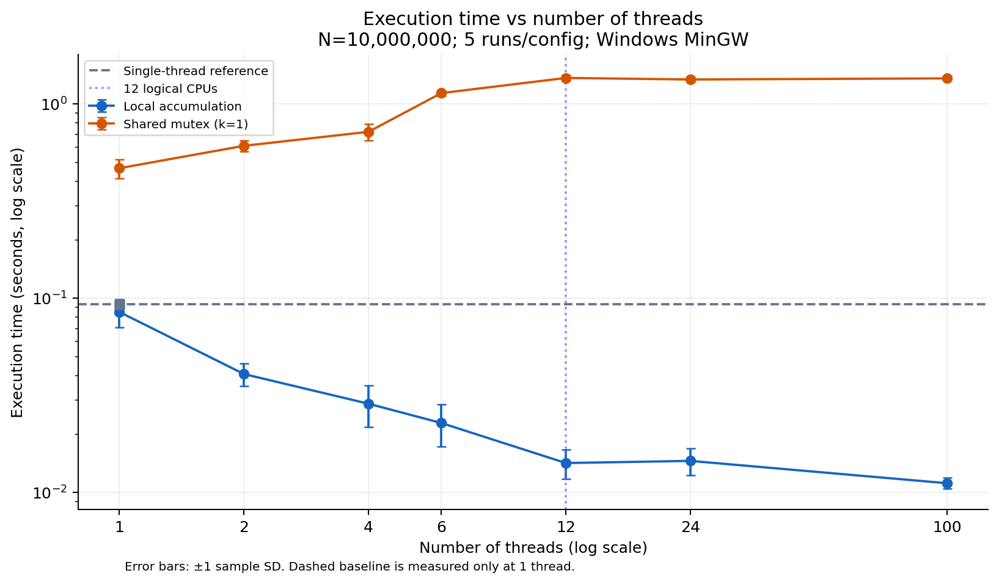
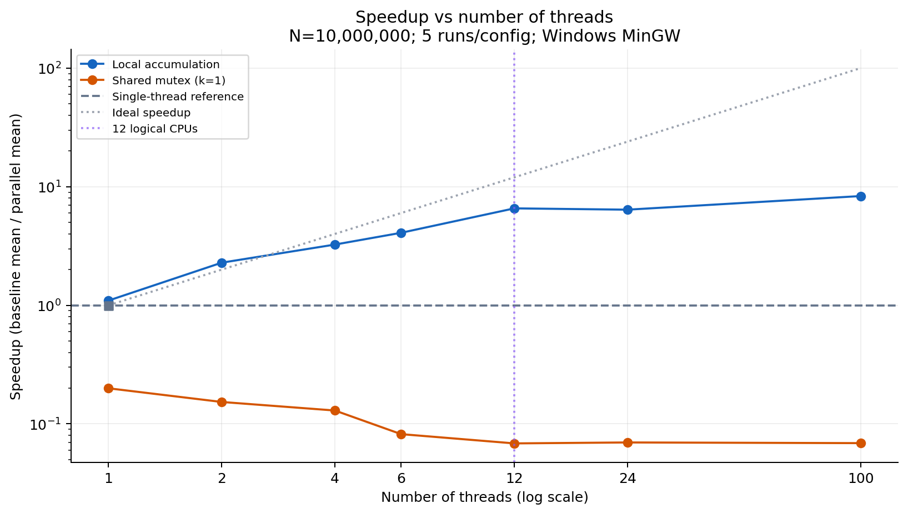
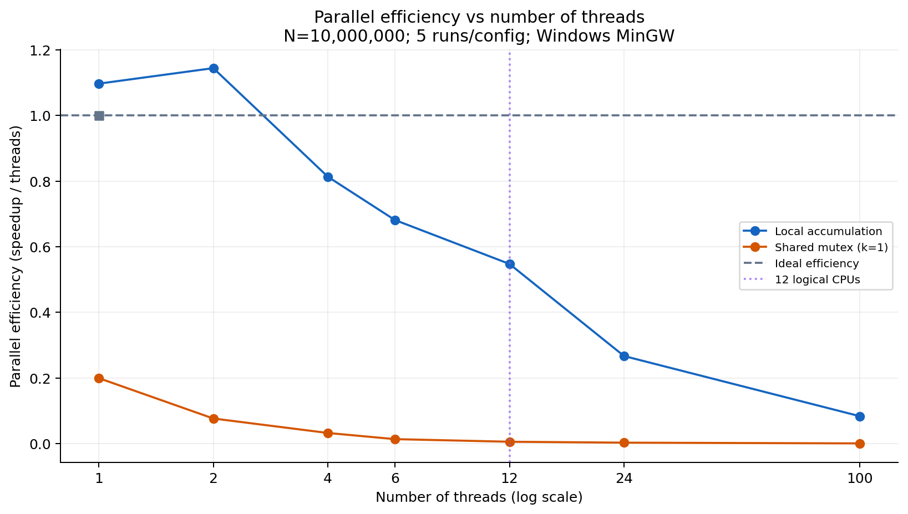
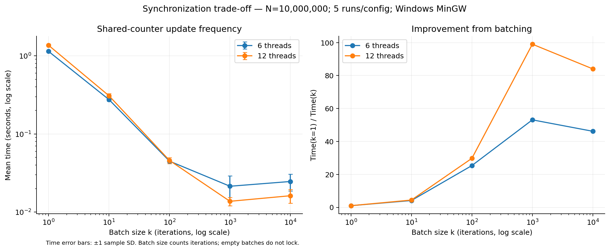

# Monte Carlo π — Experiments & Visualization

Phần Thành viên 4: thực nghiệm cả ba approach, dữ liệu từng lần chạy, tổng hợp và biểu đồ, cùng thí nghiệm tần suất cập nhật shared counter.

- [Hướng dẫn tái lập](experiments/README.md)
- [Kết quả và phân tích](results/analysis.md)
- [Dữ liệu từng lần chạy](results/raw.csv)
- [Tổng hợp](results/summary.csv)
- [Kết quả trade-off](results/tradeoff.csv)
- [Dữ liệu Excel](results/measurements.xlsx)
- [Môi trường và nguồn code](results/environment.json)

## Execution time

## Speedup

## Parallel efficiency

## Synchronization frequency trade-off

